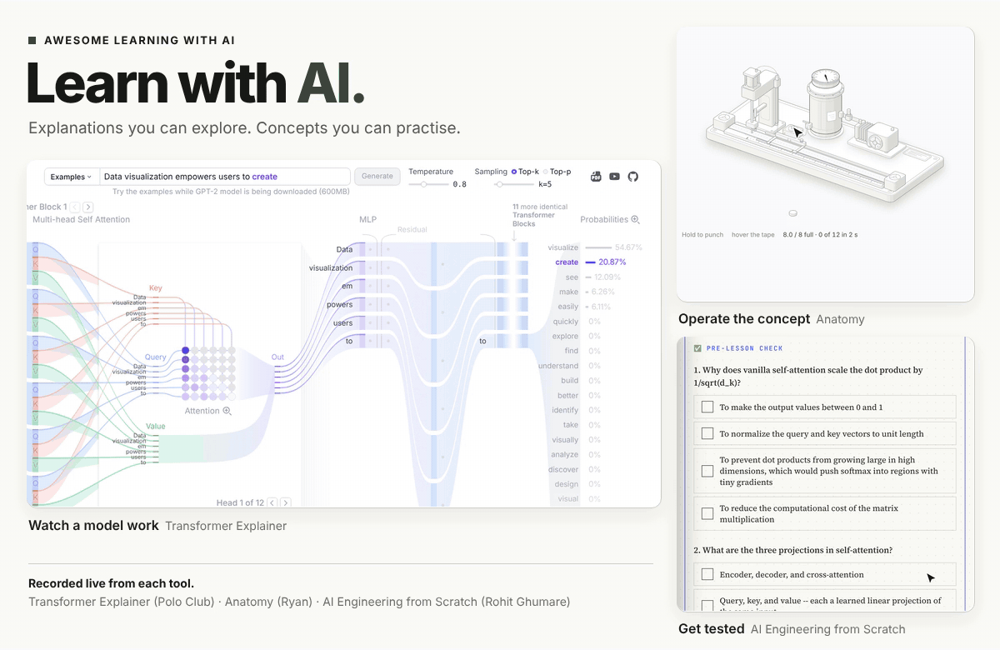
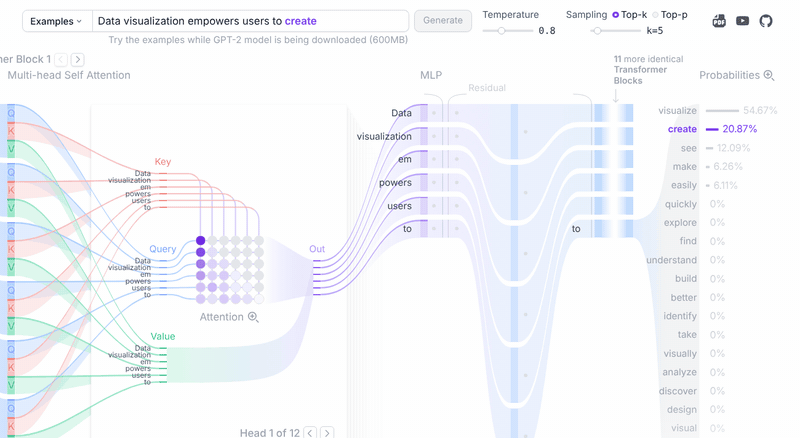
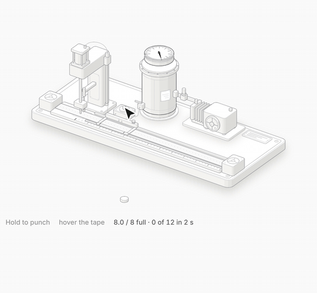
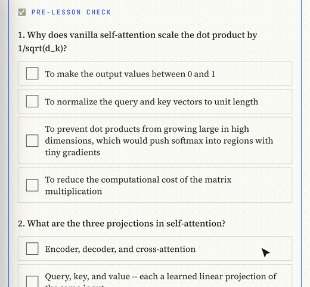
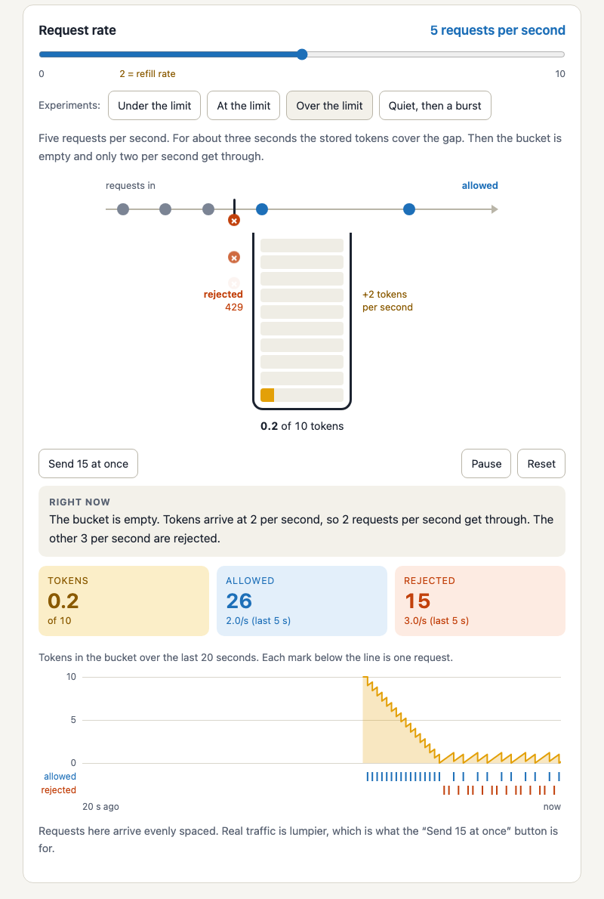
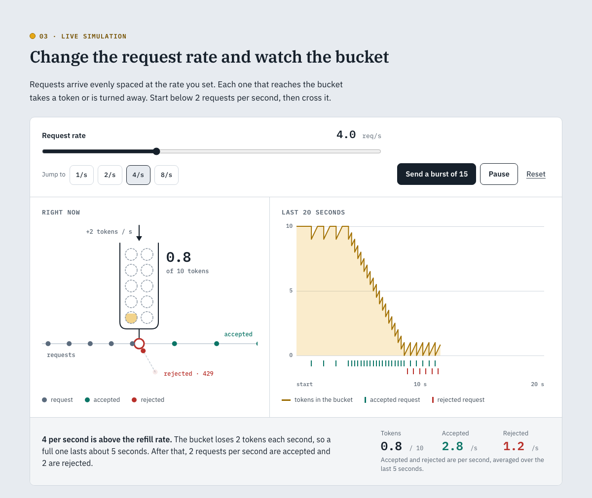

# Awesome Learning with AI

Tools for learning a technical concept with AI, picked by one test: **each gives you something to manipulate, or tests what you know.**

The list is short on purpose.

[The list](#the-list) · [Showcase](#showcase) · [Worked example](#worked-example-one-concept-three-ways) · [Workflows](#workflows) · [How entries are chosen](#how-entries-are-chosen)

## The list

Entries tagged `browser` need no install, account or API key.

### Explore a working model

- **[Transformer Explainer](https://github.com/poloclub/transformer-explainer)**: GPT-2 running in your browser. Type a sentence and watch attention and temperature change the next token. `browser` · [demo](https://poloclub.github.io/transformer-explainer/)
- **[LLM Visualization](https://github.com/bbycroft/llm-viz)**: a small GPT in 3D, walked through one step at a time. `browser` · [demo](https://bbycroft.net/llm)

### Make your own lesson

- **[Anatomy](https://github.com/wheresryan22/anatomy)**: a Claude Code skill that draws a concept as a machine you operate. A rate limiter becomes a pump, a tank and a press. `Claude Code` · [live collection](https://skills.wheresryan.sh/anatomy/collection)
- **[HTML Explainer](https://github.com/ds-vibe/html-explainer)**: an agent skill that interviews you, then builds and reviews an interactive HTML lesson. `Claude Code` · [gallery](https://ds-vibe.github.io/html-explainer/)
- **[OpenMAIC](https://github.com/THU-MAIC/OpenMAIC)**: generates a classroom from a topic or document, with slides, graded quizzes and simulations. `self-hosted`

### Practise and get tested

- **[DeepTutor](https://github.com/HKUDS/DeepTutor)**: generates and grades questions, and keeps a mastery path and learner memory between sessions. `self-hosted`
- **[Agent Tutor Skill](https://github.com/Bhala-Srinivash/agent-tutor-skill)**: a tutoring protocol for Claude Code. Explain it back before moving on, quizzes without hints. `Claude Code`
- **[sidecard](https://github.com/phunterlau/sidecard)**: a Claude Code mod that shows recall cards under the spinner while your agent works. Answers come after a countdown, and fading cards come back. `Claude Code`

### Follow a path

- **[AI Engineering from Scratch](https://github.com/rohitg00/ai-engineering-from-scratch)**: about 500 build-it-yourself lessons from math foundations to agents, most with a quiz. `browser` · [website](https://aiengineeringfromscratch.com)

## Showcase

### Transformer Explainer: watch a real model work

*In the recording: the attention matrix hovered, then expanded into dot product, scaling and mask, and softmax. Heads 1 to 3, the sampling formula for the top token, and the temperature moved down, then up, while the odds sharpen and flatten.*

**[Live demo](https://poloclub.github.io/transformer-explainer/)** · **[Repository](https://github.com/poloclub/transformer-explainer)** · Interactive resource

GPT-2 running in your browser. Type your own text, pick an attention head, step through the masked attention matrix, and move the temperature slider to see the next-token probabilities change. No assistant is involved. It is here because it sets the bar: this is what the tools that generate lessons are trying to produce.

**Start with** a sentence of five or six words. [Understand attention](workflows/understand-attention.md) says what to look for.

**Needs:** a browser. The examples work at once; your own text waits for a 600 MB model download.

### Anatomy: an idea drawn as a machine you operate

*In the recording: three figures from the live collection. A [token bucket](https://skills.wheresryan.sh/anatomy/collection/rate-limiter) pressed until the tank runs dry and presses are refused, a [temperature wheel](https://skills.wheresryan.sh/anatomy/collection/sampling) heated, spun and cooled to one pocket, and an [afterburner](https://skills.wheresryan.sh/anatomy/collection/afterburner) throttled until it lights.*

**[Repository](https://github.com/wheresryan22/anatomy)** · **[Live collection](https://skills.wheresryan.sh/anatomy/collection)** · Agent skill for Claude Code

Anatomy has Claude explain an idea by inventing a physical object whose working is the idea, then drawing it as a detailed, interactive isometric figure. A token bucket becomes [a pump, a tank and a punch press](https://skills.wheresryan.sh/anatomy/collection/rate-limiter). The skill requires that every number a figure shows comes from the model that moves its parts.

**Start with** the live collection. Pick a concept you half know, predict what the machine will do, then operate it.

**Needs:** a browser for the collection. To build: Claude Code, Node.js 20.10+, Chrome or Chromium, and 30 to 90 minutes a figure by the skill's own estimate.

### AI Engineering from Scratch: follow a path and build

*In the recording: the [self-attention lesson](https://aiengineeringfromscratch.com/lesson?path=phases/07-transformers-deep-dive/02-self-attention-from-scratch). A wrong and a right answer in the pre-lesson check, the animated attention figure, then softmax without the √d_k divisor saturating to one token.*

**[Repository](https://github.com/rohitg00/ai-engineering-from-scratch)** · **[Website](https://aiengineeringfromscratch.com)** · Curriculum with tutoring skills

Twenty phases, from math foundations to agents, with about 500 lessons. The self-attention lesson, read in full for this list, has learning objectives, a NumPy build in five steps, exercises and a quiz. AI is the subject here, not the method: the course is on the list because nearly every lesson has you build something.

**Start with** one lesson, not the whole path. [Understand attention](workflows/understand-attention.md) uses two of them.

**Needs:** a browser to read. Python to run the code. A coding agent for the tutoring skills.

## Worked example: one concept, three ways

The same request, an interactive lesson on a token bucket rate limiter, went to plain Claude and to HTML Explainer. Both were checked against three cases worked out by hand.

| | Plain Claude | HTML Explainer |
| --- | --- | --- |
| Time | 8 min | 23 min |
| Hand calculations | all pass | all pass |
| What you get | rules, one simulator, a quiz | three demos, cited sources, a quiz, more polish |

| Plain Claude | HTML Explainer |
| --- | --- |
|  |  |

The skill added depth and design, not correctness. The third way is the Anatomy author's own [token bucket figure](https://skills.wheresryan.sh/anatomy/collection/rate-limiter).

[Full notes, both pages and the checks](examples/token-bucket/README.md).

## Workflows

Manual recipes. Nothing connects the tools for you.

| Goal | Recipe | Time |
| --- | --- | --- |
| Understand attention | [Lesson, live model, your own code](workflows/understand-attention.md) | about 3 hours |
| Check that you understand a mechanism | [Predict, build, compare](workflows/explore-a-mechanism.md) | 30 minutes and up |

## How entries are chosen

An entry belongs if it does at least one of these:

- gives you something to **manipulate**: a live model, a simulation, a figure with controls
- **tests** what you know: retrieval questions, practice problems, review over time

Out of scope, however good: tools that only explain or summarize, source organizers, codebase navigators, and general chat interfaces.

Each entry also has to say what it adds over a well-written prompt to a current model. "It generates a web page" is not an answer.

## Contributing

See [CONTRIBUTING.md](CONTRIBUTING.md).

## Credits and license

Curated by [Kiril Klein](https://github.com/kirilklein). Text and layout: [MIT](LICENSE).

Cover image (`assets/cover.png`) illustration: Ryan / [Anatomy](https://github.com/wheresryan22/anatomy), MIT, reused with attribution. The hero and showcase GIFs are recordings of the projects' live pages, made with [scripts/record-showcase.cjs](scripts/record-showcase.cjs). Linked projects keep their own authors and licenses. See [THIRD_PARTY_NOTICES.md](THIRD_PARTY_NOTICES.md).
