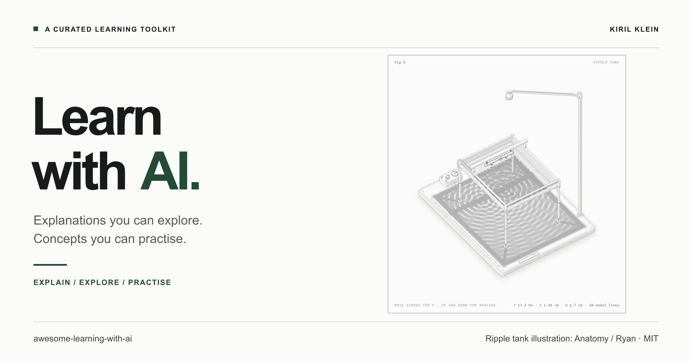

# Awesome Learning with AI

Tools for learning a technical concept with AI, picked by one test: **each gives you something to manipulate, or tests what you know.**

The list is short on purpose, and every entry says whether it was run or only read about.

[Try in 60 seconds](#try-in-60-seconds) · [Highlights](#three-highlights) · [More tools](#more-tools) · [Worked example](#worked-example-one-concept-three-ways) · [Workflows](#workflows) · [How entries are chosen](#how-entries-are-chosen)

## Try in 60 seconds

No install, no account, no API key.

- **[Transformer Explainer](https://poloclub.github.io/transformer-explainer/)**: type a sentence and watch GPT-2 choose the next token.
- **[Anatomy collection](https://skills.wheresryan.sh/anatomy/collection)**: live figures of a hash map, a B-tree, a mutex, gradient descent and more, each drawn as a machine you operate.
- **[LLM Visualization](https://bbycroft.net/llm)**: walk through a small GPT in 3D, one step at a time.
- **[HTML Explainer gallery](https://ds-vibe.github.io/html-explainer/)**: lessons generated by an agent skill, from the Doppler effect to fair use.

## Three highlights

### Anatomy: an idea drawn as a machine you operate

**[Repository](https://github.com/wheresryan22/anatomy)** · **[Live collection](https://skills.wheresryan.sh/anatomy/collection)** · Agent skill for Claude Code

Anatomy has Claude explain an idea by inventing a physical object whose working is the idea, then drawing it as a detailed, interactive isometric figure. A token bucket becomes [a pump, a tank and a punch press](https://skills.wheresryan.sh/anatomy/collection/rate-limiter). The skill requires that every number a figure shows comes from the model that moves its parts.

**Start with** the live collection. Pick a concept you half know, predict what the machine will do, then operate it.

**Making your own** is slow on purpose. The skill's instructions budget 30 to 90 minutes for its smallest figure, and it was built for figures in docs and articles. It suits explaining something you already understand.

**Needs:** a browser for the collection. To build: Claude Code, Node.js 20.10+, Chrome or Chromium.

**Status:** live figures opened; no figure built for this list.

The cover shows Ryan's published ripple tank figure. [Source and license](vendor/anatomy/SOURCE.md).

### AI Engineering from Scratch: follow a path and build

**[Repository](https://github.com/rohitg00/ai-engineering-from-scratch)** · **[Website](https://aiengineeringfromscratch.com)** · Curriculum with tutoring skills

Twenty phases, from math foundations to agents, with about 500 lessons. The self-attention lesson, read in full for this list, has learning objectives, a NumPy build in five steps, exercises and a quiz. The repository also ships agent skills that place you in the course and quiz you phase by phase.

AI is the subject here, not the method. The course is on the list because nearly every lesson has you build something, and most come with a quiz.

**Start with** one lesson, not the whole path. [Understand attention](workflows/understand-attention.md) uses two of them.

**Needs:** a browser to read. Python to run the code. A coding agent for the tutoring skills.

**Status:** docs and source read, one lesson closely. That many lessons appeared in seven months, so expect uneven quality.

### Transformer Explainer: watch a real model work

**[Live demo](https://poloclub.github.io/transformer-explainer/)** · **[Repository](https://github.com/poloclub/transformer-explainer)** · Interactive resource

GPT-2 running in your browser. Type your own text, pick an attention head, step through the masked attention matrix, and move the temperature slider to see the next-token probabilities change.

No assistant is involved. It is here because it sets the bar: this is what the tools that generate lessons are trying to produce.

**Needs:** a browser.

**Status:** docs and source read.

## More tools

| Tool | Goal | Kind | Setup | What it adds over a plain prompt | Status |
| --- | --- | --- | --- | --- | --- |
| [LLM Visualization](https://github.com/bbycroft/llm-viz) | Explore | Interactive resource | Browser ([demo](https://bbycroft.net/llm)) | A 3D walkthrough of a small GPT in ten chapters, with a working model behind it | Read |
| [HTML Explainer](https://github.com/ds-vibe/html-explainer) | Make your own | Agent skill | Claude Code or the Claude app; Playwright for its review loop | A scoping interview and a render, look, fix loop. In the test below: a deeper, better designed lesson for three times the time, and no gain in correctness | **Ran it** |
| [OpenMAIC](https://github.com/THU-MAIC/OpenMAIC) | Make your own | Self-hosted app | Local app and model provider keys | A classroom generated from a topic or document: slides, graded quizzes, simulations, project tasks | Read |
| [DeepTutor](https://github.com/HKUDS/DeepTutor) | Practise | Self-hosted app | Local app or Docker, and model providers | Question generation, quiz judging, a mastery path and learner memory that persists | Read |
| [Agent Tutor Skill](https://github.com/Bhala-Srinivash/agent-tutor-skill) | Practise | Agent skill | Claude Code | A tutoring protocol: explain it back before moving on, quizzes without hints, concept notes saved to disk. It is instructions only, and the model estimates the review schedule | Read |

**Ran it** means it was used for the worked example. **Read** means its documentation and source files were read, and it was not run.

## Worked example: one concept, three ways

The same request, an interactive lesson on a token bucket rate limiter, went to plain Claude and to HTML Explainer. Both were checked against three cases worked out by hand.

| | Plain Claude | HTML Explainer |
| --- | --- | --- |
| Time | 8 min | 23 min |
| Hand calculations | all pass | all pass |
| What you get | rules, one simulator, a quiz | three demos, cited sources, a quiz, more polish |

| Plain Claude | HTML Explainer |
| --- | --- |
|  |  |

The skill added depth and design, not correctness. The third way is the Anatomy author's own [token bucket figure](https://skills.wheresryan.sh/anatomy/collection/rate-limiter).

[Full notes, both pages and the checks](examples/token-bucket/README.md).

## Workflows

Manual recipes. Nothing connects the tools for you.

| Goal | Recipe | Time |
| --- | --- | --- |
| Understand attention | [Lesson, live model, your own code](workflows/understand-attention.md) | about 3 hours |
| Check that you understand a mechanism | [Predict, build, compare](workflows/explore-a-mechanism.md) | 30 minutes and up |

## How entries are chosen

An entry belongs if it does at least one of these:

- gives you something to **manipulate**: a live model, a simulation, a figure with controls
- **tests** what you know: retrieval questions, practice problems, review over time

Out of scope, however good: tools that only explain or summarize, source organizers, codebase navigators, and general chat interfaces.

Each entry also has to say what it adds over a well-written prompt to a current model. "It generates a web page" is not an answer.

## Contributing

See [CONTRIBUTING.md](CONTRIBUTING.md).

## Credits and license

Curated by [Kiril Klein](https://github.com/kirilklein). Text and layout: [MIT](LICENSE).

Cover illustration: Ryan / [Anatomy](https://github.com/wheresryan22/anatomy), MIT, reused with attribution. Linked projects keep their own authors and licenses. See [THIRD_PARTY_NOTICES.md](THIRD_PARTY_NOTICES.md).
